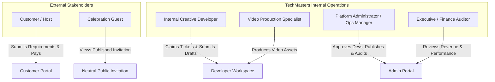
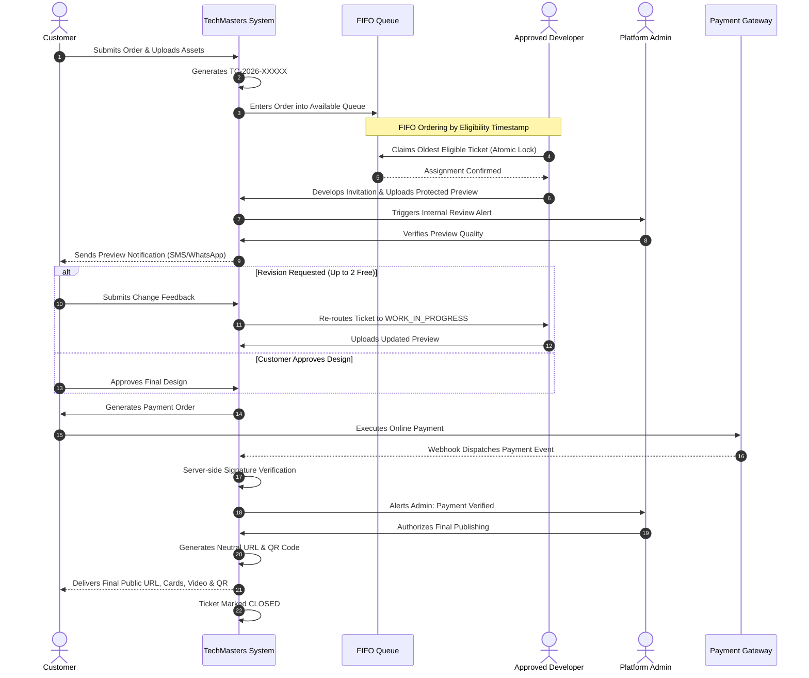

# TechMasters Digital Celebrations
## Business Requirements Document (BRD) — Version 1.1

---

### Document Control
- **Product Name:** TechMasters Digital Celebrations
- **Parent Organization:** TechMasters Innovations Private Limited
- **Document Version:** 1.1
- **Status:** Approved Baseline
- **Document Owner:** Principal Software Architect & Product Management Team
- **Target Release:** Production Release 1.0 (Managed Service Model)

---

## 1. Executive Summary & Business Context

TechMasters Innovations Private Limited is launching **TechMasters Digital Celebrations**, an enterprise-grade digital invitation service management and production platform. Unlike conventional consumer-facing invitation builders or static graphic generators, TechMasters Digital Celebrations operates as a high-touch, managed-service production engine powered by an internal ServiceNow-style ticketing system and a First-In, First-Out (FIFO) developer assignment workflow.

The core business objective is to deliver bespoke, rich-media digital celebration packages—including mobile-responsive interactive event websites, multi-format digital invitation cards (JPG, PNG, PDF), animated personalized invitation videos, QR code passes, venue mapping, and WhatsApp-ready invitation payloads—while maintaining operational discipline, zero duplicate work, rigorous financial reconciliation, and tight access controls.

The platform provides three unified portals:
1. **Customer Portal:** Frictionless order placement (no mandatory upfront registration), asset onboarding, protected preview review, revision feedback tracking, secure payment execution, and deliverable downloads.
2. **Developer Workspace:** Controlled workspace for TechMasters verified internal developers to view queue eligibility, claim tickets via an atomic FIFO engine, manage creative assets, build invitations from modular templates, upload preview artifacts, and iterate on client feedback.
3. **Admin Portal:** Central operational headquarters enabling super-admins and operations managers to approve/suspend developer accounts, monitor queue throughput, override assignments, govern pricing/packages, review designs, audit payment verifications, authorize final invitation publishing, and inspect central immutable activity logs.

---

## 2. Business Objectives & Success Metrics

### 2.1 Strategic Objectives
1. **End-to-End Service Delivery Orchestration:** Eliminate fragmented communication (email, WhatsApp, phone) by channeling every customer order into a trackable, unique ticket (`TC-YYYY-XXXXX`).
2. **Atomic Queue Fairness & Load Balancing:** Implement an automated FIFO self-assignment queue preventing ticket hoarding, duplicate claims, and manual dispatch bottlenecks.
3. **Zero Financial Leakage:** Enforce strict server-side payment verification and mandatory Admin publishing authorization before public invitation URLs and high-resolution assets are unlocked.
4. **Controlled Revisions:** Deliver two (2) complimentary revision rounds per package; systematically meter and bill subsequent revision requests according to configurable administrative policies.
5. **Decoupled Architecture for Future Self-Service:** Architect backend domain models and template engines such that a Phase 2 self-service builder and Phase 3 designer partner ecosystem can be introduced without re-engineering the database or payment core.

### 2.2 Key Performance Indicators (KPIs)

| KPI Category | Metric Name | Target Benchmark | Measurement Mechanism |
| :--- | :--- | :--- | :--- |
| **Operational Efficiency** | Average Ticket Claim Latency | < 30 minutes from eligibility | FIFO Queue audit timestamps (`created_at` to `assigned_at`) |
| **Production Speed** | First Draft Turnaround Time (TAT) | < 24 hours from assignment | Ticket lifecycle transition (`ASSIGNED` to `AWAITING_CUSTOMER_RESPONSE`) |
| **Design Quality** | First-Time Right (FTR) Approval Rate | > 65% approved in Round 1 | Design version approval counts per order |
| **Customer Satisfaction** | Average Revision Count per Order | ≤ 1.5 revision rounds | Revisions table counter |
| **Financial Integrity** | Payment Verification Reconciliation | 100% server-verified | Payment transactions audit table vs Payment gateway ledger |
| **System Reliability** | Duplicate Claim Incidence | Absolute 0 (Zero Tolerance) | Database lock contention metrics & error telemetry |

---

## 3. User Personas & Stakeholder Analysis

### 3.1 Customer (Host / Event Organizer)
- **Profile:** Individuals hosting milestone family celebrations (weddings, birthdays, anniversaries, naming ceremonies, engagements).
- **Core Needs:** High emotional value, rapid turnaround, regional language accuracy, effortless photo submission, clear progress visibility without cumbersome account creation passwords.
- **Access Pattern:** Mobile-first, OTP-based authentication, unique Order Reference lookup.

### 3.2 Internal Creative Developer
- **Profile:** Verified TechMasters digital designers and web developers responsible for creating bespoke HTML/CSS web invitations and digital cards.
- **Core Needs:** Clean visibility into available orders, transparent FIFO queue claiming, structured requirement briefs, asset management, and seamless feedback loops.
- **Constraints:** Cannot view business financials, cannot approve own account, cannot publish to production domain without Admin authorization.

### 3.3 Video Production Specialist
- **Profile:** Specialized internal TechMasters multimedia creators handling motion graphics, audio syncing, and animated MP4 video renders.
- **Core Needs:** High-resolution asset access, storyboard/slide timeline management, FFmpeg rendering tools, and dedicated video revision tracking.
- **Constraints:** Requires explicit Admin-granted `CAN_PRODUCE_VIDEO` permission.

### 3.4 Platform Administrator / Operations Manager
- **Profile:** TechMasters operations leads and senior architects overseeing delivery, queue balance, developer capacity, payment verifications, and compliance.
- **Capabilities:** Full operational override, developer vetting and onboarding, pricing/package engine configuration, final domain publishing authorization, and audit log inspection.

---

## 4. Services, Products & Packaging Specification

### 4.1 Supported Occasion Categories
1. **Birthday:** Milestone birthdays, kids themes, multi-lingual invitations, RSVP tracking, photo highlights.
2. **Naming Ceremony (Namakarana):** Traditional cultural themes, baby introduction galleries, auspicious timing (Muhurtham) highlights.
3. **Anniversary:** Silver/Golden jubilee themes, couple story timelines, venue directions, memory slideshows.
4. **Engagement:** Pre-wedding countdowns, ceremony schedules, ring ceremony visual cards, interactive map links.
5. **Marriage (Wedding):** Multi-day itineraries (Mehendi, Sangeet, Haldi, Reception), dress codes, accommodation details, gift registry notes, Google Maps integration, RSVP counters.

### 4.2 Product Deliverable Types
- **Interactive Web Invitation:** Responsive single-page web applications featuring countdown clocks, music background toggles, RSVP forms, event schedules, photo galleries, and Google Maps directions. Hosted on neutral domain paths.
- **Digital Graphic Cards:** Static and multi-slide invitation cards rendered in ultra-high resolution JPG, PNG, and print-ready PDF formats.
- **Animated Video Invitations:** Bespoke 30–90 second MP4 videos featuring animated typography, synchronized background score, slide transitions, and photo reveals.
- **QR Code Guest Access:** Dynamic QR codes encoding the verified final invitation URL for printing on traditional physical cards or distributing via WhatsApp.

### 4.3 Dynamic Package & Pricing Model (Configurable via Admin)
> [!IMPORTANT]
> **No business pricing rules or package figures may be hard-coded into frontend markup or backend business logic.** All figures listed below represent initial baseline configuration seeds managed via the dynamic Admin Pricing Engine.

#### Initial Baseline Pricing Matrix (Seed Data)
| Service / Package Name | Occasion Type | Deliverables Included | Initial Baseline Price |
| :--- | :--- | :--- | :--- |
| **Birthday Basic** | Birthday | Responsive Website + 1 Static Card (JPG/PNG) | ₹299 |
| **Naming Ceremony Standard** | Naming Ceremony | Responsive Website + 2 Cards + QR Code | ₹399 |
| **Anniversary Classic** | Anniversary | Responsive Website + Digital Card Suite + Gallery | ₹399 |
| **Engagement Elite** | Engagement | Responsive Website + Countdown + Location Map | ₹399 |
| **Marriage Standard** | Marriage | Full Event Schedule + Responsive Website + Card Suite | ₹499 |
| **Premium Marriage Grand** | Marriage | Multi-day Website + Cards + RSVP Engine + Music + QR | ₹999 |
| **Basic Video Add-On** | Any | 30s Animated Video Invitation (1080p, 1 revision) | ₹299 |
| **Premium Video Add-On** | Any | 60s Animated Video Invitation (Custom Audio, 2 revisions) | ₹499 |
| **Cinematic Video Suite** | Any | 90s+ Custom Motion Graphics Video (Multi-slide) | ₹999 onwards |

#### Configurable Add-On Modules
- Additional Revision Round (beyond free quota): Configurable base fee (e.g., ₹99 / round).
- Custom Audio Track Licensing / Upload: Configurable fee (e.g., ₹149).
- Expedited Rush Delivery (< 12 Hours): Configurable fee (e.g., ₹299).
- Extended Hosting Duration (> 90 days post-event): Configurable tier pricing.

---

## 5. Scope of the Production Release (Phase 1)

### 5.1 In-Scope Capabilities
1. **Customer Order Intake:** Multi-step wizard collecting event metadata, ceremony dates, venue GPS coordinates, regional script text, and raw media assets.
2. **Order Reference & Mobile Access:** Instant generation of human-readable ticket numbers (`TC-YYYY-XXXXX`) and frictionless mobile number + OTP verification.
3. **FIFO Assignment Engine:** Concurrency-safe, row-locked database dispatch queue allowing approved developers to claim available tickets without conflicts.
4. **Developer Workspace:** Ticket board, requirement parser, asset downloader, preview upload (watermarked/protected), and revision changelog manager.
5. **Video Production Sub-Module:** Role-gated workflow for video tasks, FFmpeg pipeline orchestration, draft MP4 previews, and final asset packaging.
6. **Customer Preview & Approval Portal:** Tokenized, protected preview viewer with built-in revision request dialogue and final acceptance handshake.
7. **Payment Verification Gateway:** Agnostic server-side payment verification pipeline with webhook idempotency, transaction auditing, and receipt generation.
8. **Admin Operations Suite:** Developer approval engine, queue monitoring, manual reassignments, publishing authorization, and pricing configuration.
9. **Neutral Publishing & Expiry Controller:** Path-based publishing on neutral Vercel domain, dynamic QR generation, and automated post-event expiration enforcement.
10. **Central Activity & Audit Logging:** Immutable audit ledger recording actor, role, timestamp, IP, action, and before/after state diffs across all business transactions.

### 5.2 Out-of-Scope (Deferred to Future Phases)
- **Phase 2:** Customer-facing self-service drag-and-drop invitation builder.
- **Phase 3:** Third-party freelance designer marketplace and commission payout disbursement module.
- **Phase 4:** Native iOS and Android mobile applications (Phase 1 targets PWA/mobile web).

---

## 6. Business Workflow & Service Level Agreements (SLAs)

### 6.1 Operational SLAs
- **Order Ingestion to Queue Entry:** < 5 seconds.
- **FIFO Claim Window:** Oldest order claimed within 2 hours during active business hours (09:00 - 21:00 IST).
- **Initial Draft Delivery:** Within 24 hours of ticket claim.
- **Revision Turnaround:** Within 8 hours of customer feedback submission.
- **Publishing Execution:** Within 30 minutes of Admin authorization and payment verification.
- **Public Hosting Lifespan:** Event Date + 30 Days default grace period (customizable up to 365 days).

---

## 7. Assumptions, Dependencies & Pending Decisions (TBD)

### 7.1 Key Assumptions
1. TechMasters internal developers have access to modern browser environments and high-speed internet connections for multi-megabyte media transfers.
2. Customers possess a valid Indian mobile number capable of receiving SMS OTPs for account verification and preview access.
3. Hosting for customer invitation websites will run on a shared, high-availability neutral Vercel deployment with dynamic path routing (`domain.com/{slug}`).

### 7.2 Pending Decisions (Marked as TBD)
- **[TBD-01: Primary Payment Gateway Selection]:** Evaluated options: Razorpay vs. Cashfree vs. PhonePe. Architecture is designed gateway-agnostic.
- **[TBD-02: SMS/WhatsApp Notification Provider]:** Evaluated options: Gupshup, Twilio, or MSG91.
- **[TBD-03: Production Neutral Domain Name]:** Exact neutral domain name without TechMasters branding is being registered by IT operations.
- **[TBD-04: Video Render Worker Compute Specification]:** Sizing of Celery FFmpeg rendering nodes based on peak concurrent wedding season projections.

