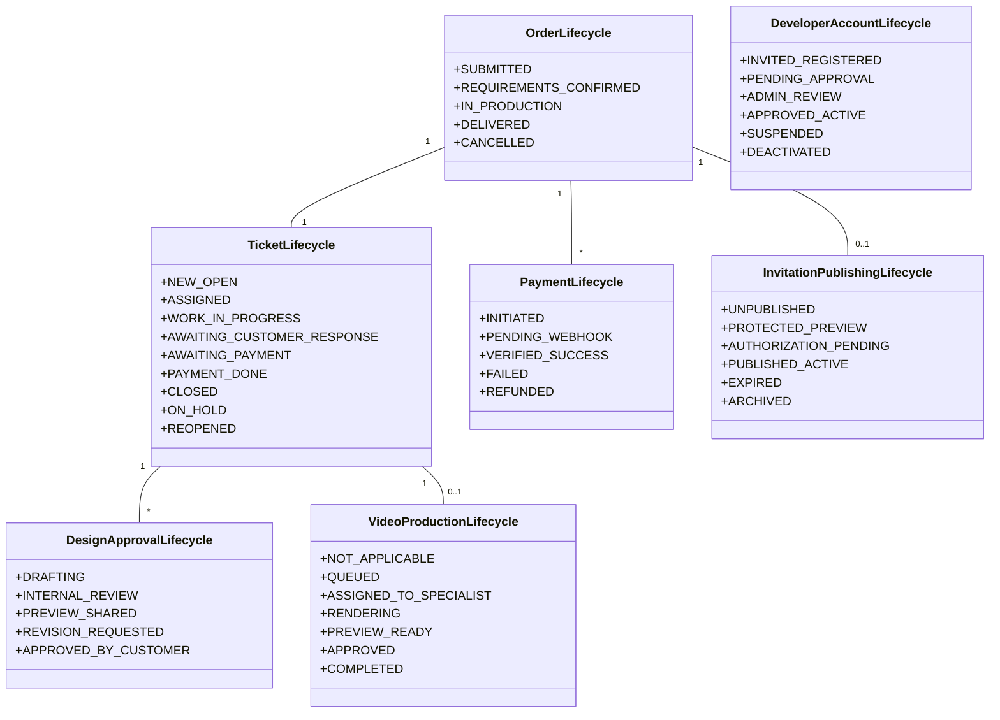
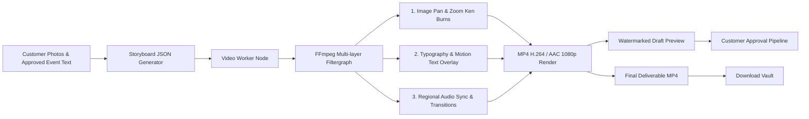

# TechMasters Digital Celebrations
## System Architecture Document (SAD) — Version 1.0

---

### Document Control
- **Product Name:** TechMasters Digital Celebrations
- **Document Version:** 1.0
- **Author:** Principal Software Architect
- **Target Stack:** React + Vite + TypeScript | Django REST Framework | PostgreSQL | Redis + Celery | Cloudflare R2 | Vercel

---

## 1. Architectural Philosophy & Principles

The architectural design of TechMasters Digital Celebrations is guided by six foundational engineering tenets:

1. **Decoupled Business Lifecycles:** Never conflate disparate domain states into a single enum. Order fulfillment, ServiceNow-style ticketing, financial transactions, design reviews, video motion rendering, and public web hosting each maintain dedicated state machines, event histories, and data models.
2. **Strict Concurrency Safety:** The First-In, First-Out (FIFO) ticket assignment engine must guarantee zero race conditions and zero duplicate assignments at the database level using atomic transactions with row-level locks (`SELECT ... FOR UPDATE SKIP LOCKED`).
3. **Defense in Depth & Least Privilege:** Role-Based Access Control (RBAC) combined with Permission-Based Access Control (PBAC). Developers have strictly partitioned access restricted only to their actively assigned orders; internal financial metrics, unassigned customer data, and system configurations remain completely invisible to developers.
4. **Server-Side Authoritative Verification:** The frontend is treated as an untrusted presentation layer. Design approval, payment verification, and public domain publishing require server-side cryptographic signatures, webhook idempotency, and explicit Admin role authorization.
5. **Neutral Branding for Public Artifacts:** Customer celebration websites, cards, and videos are delivered via neutral, unbranded public domains (e.g., hosted on Vercel), ensuring guests experience a personal celebration rather than an agency portal.
6. **Immutable Audit Trails:** Every critical business event records actor identity, IP address, user agent, module, record ID, and JSON-diffs of before-and-after states. Audit logs are write-only and cannot be updated or deleted by any system user.

---

## 2. High-Level System Architecture Diagram

```mermaid
flowchart TB
    subgraph Client Layer
        CP[Customer Portal<br/>Mobile Web & Desktop PWA]
        DW[Developer Workspace<br/>Protected Internal Portal]
        AP[Admin Control Center<br/>Operations & Governance]
        PUB[Neutral Public Invitation App<br/>neutral-domain.vercel.app/:slug]
    end

    subgraph Edge & Ingress
        CDN[Cloudflare Edge / Vercel Edge CDN<br/>SSL Termination & DDoS Shield]
        NCL[NGINX / Reverse Proxy & Rate Limiter]
    end

    subgraph Application Tier [Django REST Framework API]
        AUTH[Auth & RBAC Module<br/>JWT + Mobile OTP Engine]
        ORDER[Order & Enquiries Engine]
        TICKET[ServiceNow-Style Ticket Core]
        FIFO[Atomic FIFO Assignment Engine]
        DESIGN[Template & Design Versioning]
        PAY[Payment Gateway Adapter & Verifier]
        PUBMGR[Publishing, Slug & Expiry Engine]
        AUDIT[Immutable Central Audit Logger]
        NOTIF[Notification Dispatcher]
    end

    subgraph Async & Background Workers [Celery Workers]
        CW_GEN[General Background Worker<br/>Emails, SMS, Webhooks, QR Codes]
        CW_VID[Video Rendering Worker<br/>FFmpeg Media Composition Node]
        CELERY_BEAT[Celery Beat Scheduler<br/>Expiry Monitor, SLA Warnings]
    end

    subgraph Data & Storage Tier
        PG[(PostgreSQL Primary<br/>ACID Relational Core)]
        REDIS[(Redis In-Memory Cache<br/>Queue Broker, Rate Limits)]
        R2[(Cloudflare R2 Object Storage<br/>Assets, Previews, Watermarks, Deliverables)]
    end

    subgraph External Services
        PGW[Payment Gateway<br/>Razorpay / Cashfree API]
        SMSW[SMS & WhatsApp Gateway<br/>MSG91 / Twilio API]
        GMAPS[Google Maps Platform API]
    end

    CP --> CDN
    DW --> CDN
    AP --> CDN
    PUB --> CDN

    CDN --> NCL
    NCL --> Application Tier

    AUTH & ORDER & TICKET & FIFO & DESIGN & PAY & PUBMGR & AUDIT & NOTIF --> PG
    TICKET & FIFO & NOTIF --> REDIS
    CW_GEN & CW_VID --> REDIS
    CW_GEN & CW_VID --> PG
    CW_GEN --> R2
    CW_VID --> R2
    DESIGN --> R2
    
    PAY <--> PGW
    NOTIF --> SMSW
    PUB --> GMAPS
```

---

## 3. Tier-by-Tier Architectural Decomposition

### 3.1 Presentation Tier (Frontend)
- **Framework & Tooling:** React 18+ bootstrapped with Vite, authored in TypeScript for end-to-end type safety.
- **Styling Paradigm:** Plain, highly structured CSS utilizing CSS custom properties (design tokens) for themes, typography, spacing, and elevation. No heavy CSS-in-JS runtimes or volatile third-party UI dependencies.
- **Micro-App Structure:**
  - `/customer`: Public catalog, order submission wizard, mobile OTP verification, tokenized preview viewer, revision request dialog, and deliverable download vault.
  - `/workspace`: Authenticated developer workspace displaying active workload, available FIFO queue, asset manager, template customizer, preview uploader, and revision logs.
  - `/admin`: Super-admin operations dashboard featuring queue telemetry, developer lifecycle manager, pricing/package engine, payment reconciliation, publishing gates, and system-wide audit search.
  - `/invite/:slug`: Ultra-lightweight, high-performance, mobile-optimized public celebration viewer with countdown timers, dynamic maps, RSVP form, gallery, and music player.

### 3.2 Application & Business Logic Tier (Backend)
- **Framework:** Python 3.12+ with Django 5.x and Django REST Framework (DRF).
- **Core Architecture Modules (Django Apps):**
  1. `apps.accounts`: Custom user model, staff JWT authentication, customer OTP challenge/response, role hierarchies, developer registration, and Admin approval workflow.
  2. `apps.catalog`: Occasion types, dynamic packages, pricing tiers, and add-on configuration.
  3. `apps.orders`: Customer requirements intake, event metadata, uploaded assets, and order tracking.
  4. `apps.tickets`: ServiceNow-style ticketing system, state transition machine, internal notes, and activity timeline.
  5. `apps.assignments`: FIFO self-assignment engine, eligibility calculator, workload throttle, and assignment audit logs.
  6. `apps.designs`: Template registry, design versioning, watermarked preview generator, customer revision rounds, and approval locks.
  7. `apps.video_production`: Video production tasks, storyboard definitions, developer video assignment, and render status tracking.
  8. `apps.payments`: Gateway-agnostic payment orders, webhook listeners, server-side signature verification, idempotency locks, and transaction ledgers.
  9. `apps.publishing`: Neutral path slug generation, dynamic QR code creation, event expiry enforcement, and access token validation.
  10. `apps.notifications`: Multi-channel notification pipeline (WhatsApp, SMS, Email, In-app).
  11. `apps.audit`: Central immutable activity logger capturing structured telemetry and field-level diffs.

### 3.3 Asynchronous Processing Tier
- **Message Broker & Result Backend:** Redis 7.x.
- **Worker Clusters:**
  - `default-worker`: Handles transactional notifications (WhatsApp/SMS), QR code rendering, webhook retries, and thumbnail generation.
  - `video-worker`: High-compute container equipped with FFmpeg, font libraries, and hardware acceleration flags. Dedicated solely to multi-track audio-video rendering and animation stitching.
  - `beat-scheduler`: Periodic cron worker triggering hourly invitation expiry checks, SLA breach warnings, and unassigned queue notifications.

### 3.4 Data & Storage Tier
- **Primary Relational Store:** PostgreSQL 16+. Leverages strong transactional guarantees, check constraints, composite unique indexes, JSONB for flexible event metadata, and row-level locking.
- **Object Storage:** Cloudflare R2 (S3-compatible API) with Zero-Egress fees.
  - Bucket structure:
    - `assets/raw/{order_ref}/`: Original customer photos and documents.
    - `previews/{order_ref}/`: Watermarked, low-resolution review drafts (served via short-lived signed URLs).
    - `deliverables/{order_ref}/`: Final print-ready cards, MP4 videos, and QR codes.

---

## 4. Decoupled Multi-Lifecycle Architecture

A fundamental flaw of basic e-commerce systems is overloading a single `status` column (e.g. `order.status = 'PENDING'`). TechMasters Digital Celebrations explicitly decouples seven concurrent lifecycles:



---

## 5. Security Architecture Highlights

1. **Authentication Boundary:**
   - TechMasters Staff (Admins, Developers): Authenticate using Email + Password with Argon2 hashing and short-lived JWTs (15 min access, 7 day sliding refresh).
   - Customers: Authenticate via Mobile Number + HMAC-signed 6-digit OTP (5-minute TTL, maximum 3 attempts per window, backed by Redis rate limits).
2. **Access Control (RBAC + PBAC):**
   - Developer ticket access is strictly enforced at query-level: `Ticket.objects.filter(assigned_developer=request.user)`. Developers cannot query tickets claimed by peers.
   - Admin capabilities require explicit role flag `is_staff=True, role='ADMIN'`.
   - Video production tasks require `can_produce_video=True` permission flag.
3. **Protected Previews:** Customer previews are watermarked dynamically and served via token-protected URLs that expire after 24 hours. Previews are never public or indexable by search engines.
4. **Publishing Air-Gap:** Public URLs and QR codes are activated only when:
   $$\text{Verified Payment} = \text{TRUE} \quad \land \quad \text{Admin Publishing Authorization} = \text{TRUE}$$
5. **Storage Isolation:** Raw assets and deliverables are stored in private buckets and delivered strictly through pre-signed time-bounded URLs.

---

## 6. Video Production Architecture (FFmpeg Pipeline)



- **Separation of Concerns:** Video production tasks are decoupled from website tickets into a distinct `VideoTask` model.
- **Compute Isolation:** Video rendering is handled by an isolated Celery queue (`celery -Q video_render`) running on high-CPU worker instances to prevent blocking standard web API requests.
- **Configurable Attributes:** Video duration, transition easing, background score selection, and resolution presets are driven by package metadata rather than hardcoded scripts.

