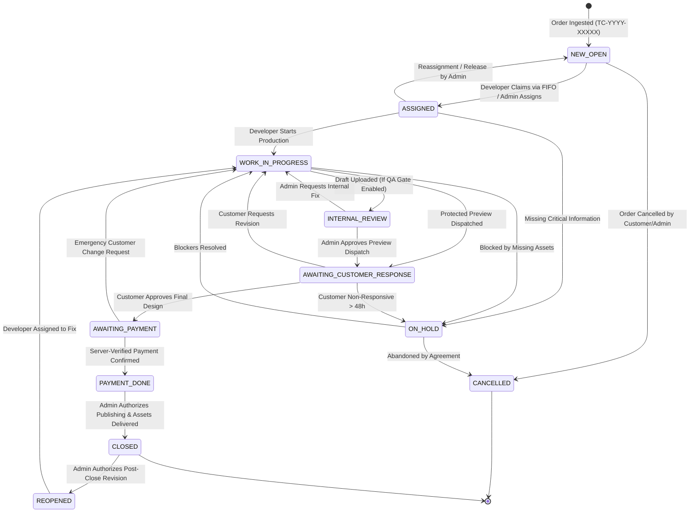

# TechMasters Digital Celebrations
## Ticket Lifecycle & State Transition Specification — Version 1.0

---

### Document Control
- **Product Name:** TechMasters Digital Celebrations
- **Document Version:** 1.0
- **Author:** Principal Software Architect & Systems Workflow Analyst
- **Baseline Reference:** BRD v1.1, SAD v1.0, FRS v1.0

---

## 1. Ticket Lifecycle State Machine

The ticketing system in TechMasters Digital Celebrations is modeled as a deterministic finite-state machine (FSM). Arbitrary or unregulated status updates are strictly prohibited. Every state transition triggers automated audit logs, state-change hooks, and customer/staff notifications.

---

## 2. Permitted State Transition Matrix

| Current State | Target State | Permitted Actors | Pre-conditions | Automated Actions & Side Effects |
| :--- | :--- | :--- | :--- | :--- |
| **`NEW_OPEN`** | `ASSIGNED` | `DEV_ACTIVE`, `DEV_VIDEO`, `OPS_ADMIN` | Ticket has no assigned developer; Developer has not exceeded active ticket quota. | Row locked; `assigned_developer_id` set; `assigned_at` timestamp set; audit logged; FIFO queue refreshed. |
| **`NEW_OPEN`** | `CANCELLED` | `OPS_ADMIN`, `AUTH_CUSTOMER` | Order not yet started. | Cancellation reason recorded; customer notified via SMS. |
| **`ASSIGNED`** | `WORK_IN_PROGRESS` | `DEV_ACTIVE` (Owner), `OPS_ADMIN` | Ticket assigned to actor. | `wip_started_at` logged; ticket moves to active WIP swimlane. |
| **`ASSIGNED`** | `NEW_OPEN` | `OPS_ADMIN` | Admin intervention / developer unable to complete. | `assigned_developer_id` cleared; ticket re-enters FIFO queue; reassignment audit recorded. |
| **`WORK_IN_PROGRESS`** | `INTERNAL_REVIEW` | `DEV_ACTIVE` (Owner) | Protected preview link or media files uploaded. | Internal review notification sent to Admin; review task created. |
| **`WORK_IN_PROGRESS`** | `AWAITING_CUSTOMER_RESPONSE` | `DEV_ACTIVE` (Owner), `OPS_ADMIN` | Protected preview URL active and watermarked card drafts uploaded. | Customer notified via WhatsApp/SMS with preview link; preview expiry timer started. |
| **`WORK_IN_PROGRESS`** | `ON_HOLD` | `DEV_ACTIVE` (Owner), `OPS_ADMIN` | Mandatory reason provided (e.g. illegible photo, missing Muhurtham time). | Customer alerted to provide missing detail; SLA clock paused. |
| **`INTERNAL_REVIEW`** | `WORK_IN_PROGRESS` | `OPS_ADMIN` | Admin internal feedback provided. | Developer notified of required internal changes. |
| **`INTERNAL_REVIEW`** | `AWAITING_CUSTOMER_RESPONSE` | `OPS_ADMIN` | Admin approves draft quality. | Customer notified with protected preview link. |
| **`AWAITING_CUSTOMER_RESPONSE`** | `WORK_IN_PROGRESS` | `AUTH_CUSTOMER`, `OPS_ADMIN` | Customer submits structured revision notes; Revision count incremented. | Ticket flagged with revision badge; developer alerted; SLA reset for revision. |
| **`AWAITING_CUSTOMER_RESPONSE`** | `AWAITING_PAYMENT` | `AUTH_CUSTOMER`, `OPS_ADMIN` | Customer approves design; Design marked as `APPROVED_BY_CUSTOMER`. | Payment order created with payment gateway; customer redirected to invoice. |
| **`AWAITING_PAYMENT`** | `PAYMENT_DONE` | System (Webhook), `OPS_ADMIN` | Server-verified cryptographic webhook signature from payment gateway. | Payment transaction marked `SUCCESS`; Admin notified for publishing gate. |
| **`PAYMENT_DONE`** | `CLOSED` | `OPS_ADMIN` | Admin executes `AUTHORIZE_PUBLISHING`; Neutral URL active; QR code generated. | Final deliverables unlocked for customer; delivery notification dispatched; SLA finalized. |
| **`CLOSED`** | `REOPENED` | `OPS_ADMIN` | Valid customer appeal or venue change post-delivery. | Reopened ticket counter incremented; reason required in audit. |
| **`ON_HOLD`** | `WORK_IN_PROGRESS` | `DEV_ACTIVE` (Owner), `OPS_ADMIN` | Missing info supplied by customer. | SLA clock resumed; developer notified. |

---

## 3. Customer-Facing Status Abstraction

To ensure an intuitive, reassuring customer experience and avoid exposing internal operational friction, customer-facing statuses are sanitized abstractions of internal ticket states:

| Internal Ticket Status | Customer-Facing Status Label | Customer Portal Explanation |
| :--- | :--- | :--- |
| `NEW_OPEN` | **Order Received** | "Your celebration requirements have been received and logged. Our creative team will pick this up shortly." |
| `ASSIGNED` | **Design Team Assigned** | "A dedicated TechMasters designer has been assigned to your celebration." |
| `WORK_IN_PROGRESS` | **Designing Your Invitation** | "Our creative team is crafting your personalized digital invitation and cards." |
| `INTERNAL_REVIEW` | **Quality Check in Progress** | "Our senior creative director is reviewing your invitation drafts to ensure perfection." |
| `AWAITING_CUSTOMER_RESPONSE` | **Preview Ready for Review** | "Your personalized preview is ready! Please review and approve or suggest changes." |
| `AWAITING_PAYMENT` | **Design Approved — Awaiting Payment** | "You have approved the design. Please complete payment to unlock your public link and HD files." |
| `PAYMENT_DONE` | **Payment Received — Finalizing Publishing** | "Payment confirmed. Our team is generating your high-res cards, QR code, and public link." |
| `CLOSED` | **Celebration Live & Delivered** | "Your digital celebration is live! Access your public invitation link, QR code, and final files below." |
| `ON_HOLD` | **Clarification Required** | "We need a quick detail to proceed with your invitation. Please check the notes or contact support." |
| `CANCELLED` | **Order Cancelled** | "This order has been cancelled. Please contact support if you need assistance." |

---

## 4. Multi-Lifecycle State Coordination

The system guarantees synchronization across decoupled domain entities through event signals:

| Event Trigger | Ticket Status | Order Status | Payment Status | Design Status | Publishing Status |
| :--- | :--- | :--- | :--- | :--- | :--- |
| **Order Ingested** | `NEW_OPEN` | `SUBMITTED` | `UNPAID` | `NOT_STARTED` | `UNPUBLISHED` |
| **FIFO Claimed** | `ASSIGNED` | `IN_PRODUCTION`| `UNPAID` | `DRAFTING` | `UNPUBLISHED` |
| **Preview Uploaded** | `AWAITING_CUSTOMER_RESPONSE`| `IN_PRODUCTION`| `UNPAID` | `PREVIEW_SHARED`| `PROTECTED_PREVIEW`|
| **Customer Approves** | `AWAITING_PAYMENT` | `IN_PRODUCTION`| `INITIATED` | `APPROVED` | `AUTHORIZATION_PENDING` |
| **Payment Verified** | `PAYMENT_DONE` | `IN_PRODUCTION`| `VERIFIED_SUCCESS`| `LOCKED` | `AUTHORIZATION_PENDING` |
| **Admin Publishes** | `CLOSED` | `DELIVERED` | `VERIFIED_SUCCESS`| `LOCKED` | `PUBLISHED_ACTIVE` |
| **Event + 30 Days** | `CLOSED` | `DELIVERED` | `VERIFIED_SUCCESS`| `LOCKED` | `EXPIRED` |

