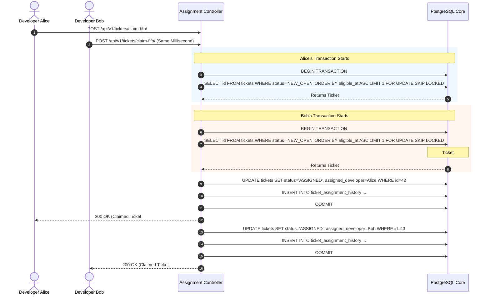

# TechMasters Digital Celebrations
## FIFO Assignment Logic & Concurrency Engine — Version 1.0

---

### Document Control
- **Product Name:** TechMasters Digital Celebrations
- **Document Version:** 1.0
- **Author:** Principal Database Architect & Systems Concurrency Specialist
- **Baseline Reference:** BRD v1.1, SAD v1.0, FRS v1.0

---

## 1. FIFO Assignment Principles

The TechMasters ticket assignment model is built on an automated First-In, First-Out (FIFO) self-assignment queue. To ensure fairness, prevent cherry-picking, and avoid management dispatch bottlenecks:
1. **Timestamp-Based Priority:** Orders enter the queue strictly according to their `eligible_at` timestamp (the moment customer requirements and assets are validated).
2. **Oldest-First Dispatch:** When an approved developer requests a ticket claim, the engine targets the oldest eligible unclaimed ticket in the queue.
3. **Strict Concurrency Safety:** Two or more developers clicking "Claim Ticket" at the exact same millisecond must NEVER result in both claiming the same ticket or corrupting state.
4. **Autonomous Operation:** Platform administrators do not need to manually push every ticket; the queue runs autonomously while retaining full Admin visibility and override capabilities.

---

## 2. Queue Eligibility Criteria

A ticket is considered eligible for FIFO claiming if and only if all of the following conditions are met:
1. `ticket.status == 'NEW_OPEN'`
2. `ticket.assigned_developer IS NULL`
3. `order.status in ['SUBMITTED', 'REQUIREMENTS_CONFIRMED']`
4. `ticket.is_on_hold == FALSE`
5. `ticket.eligible_at IS NOT NULL`

---

## 3. Developer Workload & Claim Throttling

To prevent individual developers from hoarding tickets or suffering burnout while other team members sit idle, the engine enforces strict workload throttling:
- Each developer profile defines `max_active_tickets` (default: 3, configurable per developer by Admin).
- When attempting to claim a ticket, the system calculates the developer's current active load:
  $$\text{active\_load} = \text{Count}(\text{Tickets where } \text{assigned\_developer} = \text{user} \land \text{status} \in [\text{'ASSIGNED'}, \text{'WORK\_IN\_PROGRESS'}, \text{'INTERNAL\_REVIEW'}]))$$
- If $\text{active\_load} \ge \text{max\_active\_tickets}$, the claim attempt is rejected with an HTTP 409 Conflict error: `"Maximum active workload reached. Please progress or complete your current assigned tickets before claiming new work."`

---

## 4. Concurrency & Atomic Database Locking Architecture

### 4.1 The Race Condition Threat
Without atomic database-level locks, two developers querying the queue simultaneously could read the same oldest ticket `TC-2026-00042` as unclaimed, and both submit an assignment update, causing inconsistent states, double work, and customer confusion.

### 4.2 Solution: PostgreSQL `FOR UPDATE SKIP LOCKED`
We leverage PostgreSQL's native row-level pessimistic locking mechanism:
- `SELECT ... FOR UPDATE`: Locks the selected row exclusively within the transaction.
- `SKIP LOCKED`: If another concurrent transaction is currently evaluating or claiming the oldest row, subsequent transactions do not block or wait; they skip the locked row and claim the next available oldest ticket in the FIFO queue, or fail gracefully if no other tickets exist.



---

## 5. Technical Implementation Blueprint (Python / Django)

```python
from django.db import transaction
from django.utils import timezone
from rest_framework.exceptions import ValidationError, NotFound
from apps.tickets.models import Ticket, TicketAssignmentHistory, TicketStatus
from apps.audit.services import log_activity

def claim_next_fifo_ticket(developer_user, client_ip=None):
    """
    Atomically claims the oldest eligible ticket for the requesting developer.
    Guarantees zero duplicate claims via row-level locks.
    """
    # 1. Verify developer account state
    if developer_user.role not in ['DEV_ACTIVE', 'DEV_VIDEO']:
        raise ValidationError("Only approved active developers can claim tickets.")
    if developer_user.approval_status != 'APPROVED_ACTIVE':
        raise ValidationError("Your developer account is pending approval or suspended.")

    # 2. Check current active workload limit
    active_statuses = [TicketStatus.ASSIGNED, TicketStatus.WORK_IN_PROGRESS, TicketStatus.INTERNAL_REVIEW]
    current_workload = Ticket.objects.filter(
        assigned_developer=developer_user,
        status__in=active_statuses
    ).count()

    max_allowed = getattr(developer_user, 'max_active_tickets', 3)
    if current_workload >= max_allowed:
        raise ValidationError(
            f"Workload limit exceeded ({current_workload}/{max_allowed}). "
            "Please deliver current drafts before claiming new tickets."
        )

    # 3. Atomic Database Claim with FOR UPDATE SKIP LOCKED
    with transaction.atomic():
        # Select the single oldest eligible ticket, locking the row exclusively
        ticket = (
            Ticket.objects.select_for_update(skip_locked=True)
            .filter(
                status=TicketStatus.NEW_OPEN,
                assigned_developer__isnull=True,
                is_on_hold=False
            )
            .order_by('eligible_at')
            .first()
        )

        if not ticket:
            raise NotFound("No eligible tickets currently available in the queue.")

        previous_status = ticket.status

        # Update ticket state
        ticket.assigned_developer = developer_user
        ticket.status = TicketStatus.ASSIGNED
        ticket.assigned_at = timezone.now()
        ticket.save(update_fields=['assigned_developer', 'status', 'assigned_at', 'updated_at'])

        # Record permanent assignment audit history
        TicketAssignmentHistory.objects.create(
            ticket=ticket,
            developer=developer_user,
            assigned_by=developer_user,
            assignment_type='FIFO_SELF_CLAIM',
            notes=f"Self-claimed via FIFO queue. Workload at claim: {current_workload + 1}/{max_allowed}."
        )

        # Record Central Activity Log
        log_activity(
            actor=developer_user,
            role=developer_user.role,
            action='TICKET_CLAIMED_FIFO',
            module='ASSIGNMENTS',
            record_id=str(ticket.id),
            previous_value={'status': previous_status, 'assigned_developer': None},
            new_value={'status': ticket.status, 'assigned_developer': str(developer_user.id)},
            ip_address=client_ip,
            status='SUCCESS'
        )

        return ticket
```

---

## 6. Admin Manual Override & Reassignment Mechanics

While the FIFO queue handles day-to-day claims, Admin retains complete oversight:
- **Manual Assignment:** Admin can directly assign any ticket to a specific developer (e.g. for VIP orders or specific regional language expertise), bypassing FIFO ordering.
- **Reassignment / Revocation:** Admin can revoke an assignment if a developer becomes unavailable or breaches SLA. The ticket can either be assigned to another developer or released back to `NEW_OPEN` status with its original `eligible_at` timestamp preserved (ensuring it stays at the top of the queue).
- **Mandatory Audit Justification:** All manual Admin assignments and reassignments require an audit reason logged in `TicketAssignmentHistory`.

