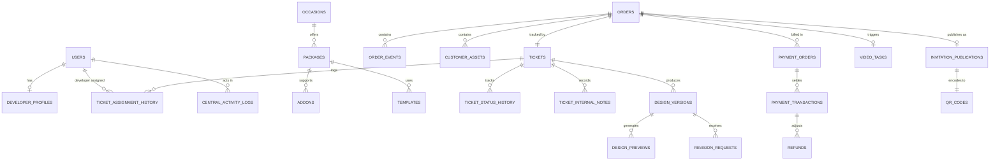

# TechMasters Digital Celebrations
## Database Design & Entity Relationship Diagram (ERD) — Version 1.0

---

### Document Control
- **Product Name:** TechMasters Digital Celebrations
- **Document Version:** 1.0
- **Database Engine:** PostgreSQL 16+
- **Author:** Senior Database Architect
- **Baseline Reference:** BRD v1.1, SAD v1.0, FRS v1.0

---

## 1. Relational Schema Architecture

The database architecture is designed in Third Normal Form (3NF), separating transactional lifecycles into dedicated tables while using PostgreSQL `JSONB` columns for structured, multi-event ceremony details (such as multi-day Indian wedding schedules).

---

## 2. Comprehensive Table Definitions

### 2.1 Domain: Identity, Accounts & Roles

#### Table: `users`
| Column Name | Data Type | Constraints | Description |
| :--- | :--- | :--- | :--- |
| `id` | `UUID` | `PRIMARY KEY, DEFAULT gen_random_uuid()` | Unique user identifier. |
| `email` | `VARCHAR(255)` | `UNIQUE, NULLABLE` | Email for staff login (Admin/Dev). |
| `phone_number`| `VARCHAR(20)` | `UNIQUE, NULLABLE, INDEXED` | Mobile number for customer verification/staff. |
| `password_hash`| `VARCHAR(255)`| `NULLABLE` | Argon2 hashed password (null for OTP-only customers). |
| `full_name` | `VARCHAR(150)` | `NOT NULL` | Display name. |
| `role` | `VARCHAR(30)` | `NOT NULL, CHECK (role IN ('ANON_GUEST', 'AUTH_CUSTOMER', 'DEV_PENDING', 'DEV_ACTIVE', 'DEV_VIDEO', 'OPS_ADMIN', 'SUPER_ADMIN'))` | Primary role. |
| `is_active` | `BOOLEAN` | `NOT NULL, DEFAULT TRUE` | Active account flag. |
| `created_at` | `TIMESTAMPTZ` | `NOT NULL, DEFAULT NOW()` | Creation timestamp. |
| `updated_at` | `TIMESTAMPTZ` | `NOT NULL, DEFAULT NOW()` | Last update timestamp. |

#### Table: `developer_profiles`
| Column Name | Data Type | Constraints | Description |
| :--- | :--- | :--- | :--- |
| `id` | `UUID` | `PRIMARY KEY, DEFAULT gen_random_uuid()` | Profile record ID. |
| `user_id` | `UUID` | `NOT NULL, UNIQUE, FK -> users(id) ON DELETE CASCADE` | References user record. |
| `approval_status`| `VARCHAR(30)`| `NOT NULL, DEFAULT 'PENDING_APPROVAL', CHECK (approval_status IN ('PENDING_APPROVAL', 'APPROVED_ACTIVE', 'REJECTED', 'SUSPENDED'))` | Admin approval state. |
| `approved_by_id`| `UUID` | `NULLABLE, FK -> users(id)` | Admin who approved the account. |
| `approved_at` | `TIMESTAMPTZ` | `NULLABLE` | Timestamp of Admin approval. |
| `can_produce_video`| `BOOLEAN` | `NOT NULL, DEFAULT FALSE` | Video specialist capability flag. |
| `max_active_tickets`| `INTEGER` | `NOT NULL, DEFAULT 3, CHECK (max_active_tickets > 0)` | Maximum concurrent tickets permitted. |
| `portfolio_url` | `VARCHAR(500)`| `NULLABLE` | Portfolio / resume link. |
| `skills` | `JSONB` | `DEFAULT '[]'` | Skills tags (e.g. HTML, Animation, Kannada, Hindi). |

#### Table: `otp_challenges`
| Column Name | Data Type | Constraints | Description |
| :--- | :--- | :--- | :--- |
| `id` | `UUID` | `PRIMARY KEY, DEFAULT gen_random_uuid()` | Challenge ID. |
| `phone_number` | `VARCHAR(20)` | `NOT NULL, INDEXED` | Mobile number challenged. |
| `otp_hash` | `VARCHAR(255)` | `NOT NULL` | HMAC-SHA256 hash of 6-digit OTP. |
| `order_reference`| `VARCHAR(30)`| `NULLABLE, INDEXED` | Associated order if authenticating for order lookup. |
| `attempts_count`| `INTEGER` | `NOT NULL, DEFAULT 0` | Failed attempts counter (max 3). |
| `expires_at` | `TIMESTAMPTZ` | `NOT NULL` | Expiry timestamp (5-minute TTL). |
| `is_consumed` | `BOOLEAN` | `NOT NULL, DEFAULT FALSE` | Single-use flag. |
| `created_at` | `TIMESTAMPTZ` | `NOT NULL, DEFAULT NOW()` | Creation timestamp. |

---

### 2.2 Domain: Service Catalog & Dynamic Pricing

#### Table: `occasions`
| Column Name | Data Type | Constraints | Description |
| :--- | :--- | :--- | :--- |
| `id` | `UUID` | `PRIMARY KEY, DEFAULT gen_random_uuid()` | Occasion ID. |
| `slug` | `VARCHAR(50)` | `UNIQUE, NOT NULL` | URL slug (e.g. `marriage`, `birthday`). |
| `display_name` | `VARCHAR(100)` | `NOT NULL` | Display title (e.g. "Marriage / Wedding"). |
| `description` | `TEXT` | `NOT NULL` | Public description. |
| `is_active` | `BOOLEAN` | `NOT NULL, DEFAULT TRUE` | Active visibility flag. |
| `sort_order` | `INTEGER` | `NOT NULL, DEFAULT 0` | UI display ordering. |

#### Table: `packages`
| Column Name | Data Type | Constraints | Description |
| :--- | :--- | :--- | :--- |
| `id` | `UUID` | `PRIMARY KEY, DEFAULT gen_random_uuid()` | Package ID. |
| `occasion_id` | `UUID` | `NOT NULL, FK -> occasions(id) ON DELETE CASCADE` | Associated occasion. |
| `name` | `VARCHAR(100)` | `NOT NULL` | Package name (e.g. "Premium Marriage Grand"). |
| `code` | `VARCHAR(50)` | `UNIQUE, NOT NULL` | Internal code (e.g. `PKG_WEDDING_PREMIUM`). |
| `base_price_inr` | `DECIMAL(10,2)`| `NOT NULL, CHECK (base_price_inr >= 0)` | Configurable base price in INR. |
| `features_json` | `JSONB` | `NOT NULL, DEFAULT '[]'` | Structured array of included features. |
| `included_revisions`| `INTEGER` | `NOT NULL, DEFAULT 2` | Complimentary revision rounds count. |
| `is_active` | `BOOLEAN` | `NOT NULL, DEFAULT TRUE` | Admin toggle for availability. |
| `created_at` | `TIMESTAMPTZ` | `NOT NULL, DEFAULT NOW()` | Creation timestamp. |

#### Table: `addons`
| Column Name | Data Type | Constraints | Description |
| :--- | :--- | :--- | :--- |
| `id` | `UUID` | `PRIMARY KEY, DEFAULT gen_random_uuid()` | Add-on ID. |
| `name` | `VARCHAR(100)` | `NOT NULL` | Add-on name (e.g. "Basic Video Invitation"). |
| `code` | `VARCHAR(50)` | `UNIQUE, NOT NULL` | Unique code (e.g. `ADDON_VIDEO_BASIC`). |
| `price_inr` | `DECIMAL(10,2)`| `NOT NULL, CHECK (price_inr >= 0)` | Configurable add-on price in INR. |
| `addon_type` | `VARCHAR(50)` | `NOT NULL, CHECK (addon_type IN ('VIDEO', 'REVISION', 'RUSH_DELIVERY', 'HOSTING_EXT'))` | Type category. |
| `is_active` | `BOOLEAN` | `NOT NULL, DEFAULT TRUE` | Toggle switch. |

---

### 2.3 Domain: Orders & Customer Assets

#### Table: `orders`
| Column Name | Data Type | Constraints | Description |
| :--- | :--- | :--- | :--- |
| `id` | `UUID` | `PRIMARY KEY, DEFAULT gen_random_uuid()` | Order record ID. |
| `order_reference`| `VARCHAR(30)` | `UNIQUE, NOT NULL, INDEXED` | Human-readable ID (e.g. `TC-2026-00001`). |
| `customer_name` | `VARCHAR(150)` | `NOT NULL` | Host / contact person name. |
| `customer_mobile`| `VARCHAR(20)` | `NOT NULL, INDEXED` | Customer mobile number for notifications/OTP. |
| `customer_email` | `VARCHAR(255)` | `NULLABLE` | Optional email. |
| `occasion_id` | `UUID` | `NOT NULL, FK -> occasions(id)` | Occasion category. |
| `package_id` | `UUID` | `NOT NULL, FK -> packages(id)` | Selected package. |
| `selected_language`| `VARCHAR(30)` | `NOT NULL, DEFAULT 'English'` | Regional language for content. |
| `status` | `VARCHAR(30)` | `NOT NULL, DEFAULT 'SUBMITTED', CHECK (status IN ('SUBMITTED', 'REQUIREMENTS_CONFIRMED', 'IN_PRODUCTION', 'DELIVERED', 'CANCELLED'))` | Order lifecycle status. |
| `total_amount_inr`| `DECIMAL(10,2)`| `NOT NULL, DEFAULT 0.00` | Calculated total payable. |
| `special_instructions`| `TEXT` | `NULLABLE` | Customer creative notes. |
| `created_at` | `TIMESTAMPTZ` | `NOT NULL, DEFAULT NOW()` | Order submission timestamp. |
| `updated_at` | `TIMESTAMPTZ` | `NOT NULL, DEFAULT NOW()` | Last update timestamp. |

#### Table: `order_events`
| Column Name | Data Type | Constraints | Description |
| :--- | :--- | :--- | :--- |
| `id` | `UUID` | `PRIMARY KEY, DEFAULT gen_random_uuid()` | Sub-event record ID. |
| `order_id` | `UUID` | `NOT NULL, FK -> orders(id) ON DELETE CASCADE` | Associated order. |
| `event_title` | `VARCHAR(150)` | `NOT NULL` | Event title (e.g. "Muhurtham", "Reception"). |
| `event_date` | `DATE` | `NOT NULL` | Date of ceremony. |
| `start_time` | `TIME` | `NOT NULL` | Start time. |
| `end_time` | `TIME` | `NULLABLE` | End time. |
| `venue_name` | `VARCHAR(200)` | `NOT NULL` | Hall / resort / residence name. |
| `venue_address` | `TEXT` | `NOT NULL` | Detailed address for navigation. |
| `google_maps_url`| `VARCHAR(500)` | `NULLABLE` | Google Maps pin link. |
| `dress_code` | `VARCHAR(100)` | `NULLABLE` | Recommended attire. |

#### Table: `customer_assets`
| Column Name | Data Type | Constraints | Description |
| :--- | :--- | :--- | :--- |
| `id` | `UUID` | `PRIMARY KEY, DEFAULT gen_random_uuid()` | Asset ID. |
| `order_id` | `UUID` | `NOT NULL, FK -> orders(id) ON DELETE CASCADE` | Parent order. |
| `file_key` | `VARCHAR(500)` | `NOT NULL` | Cloudflare R2 object key. |
| `file_name` | `VARCHAR(255)` | `NOT NULL` | Original uploaded file name. |
| `file_type` | `VARCHAR(50)` | `NOT NULL` | MIME type (image/jpeg, audio/mpeg). |
| `file_size_bytes`| `BIGINT` | `NOT NULL` | Size in bytes. |
| `asset_category` | `VARCHAR(30)` | `NOT NULL, CHECK (asset_category IN ('COUPLE_PHOTO', 'FAMILY_PHOTO', 'BACKGROUND_AUDIO', 'LOGO_ASSET', 'OTHER'))` | Categorization. |
| `uploaded_at` | `TIMESTAMPTZ` | `NOT NULL, DEFAULT NOW()` | Upload timestamp. |

---

### 2.4 Domain: ServiceNow-Style Ticketing System

#### Table: `tickets`
| Column Name | Data Type | Constraints | Description |
| :--- | :--- | :--- | :--- |
| `id` | `UUID` | `PRIMARY KEY, DEFAULT gen_random_uuid()` | Ticket UUID. |
| `ticket_number` | `VARCHAR(30)` | `UNIQUE, NOT NULL, INDEXED` | Human-readable ID matching order (e.g. `TC-2026-00001`). |
| `order_id` | `UUID` | `NOT NULL, UNIQUE, FK -> orders(id) ON DELETE CASCADE` | 1-to-1 link with order. |
| `status` | `VARCHAR(35)` | `NOT NULL, DEFAULT 'NEW_OPEN', CHECK (status IN ('NEW_OPEN', 'ASSIGNED', 'WORK_IN_PROGRESS', 'INTERNAL_REVIEW', 'AWAITING_CUSTOMER_RESPONSE', 'AWAITING_PAYMENT', 'PAYMENT_DONE', 'CLOSED', 'ON_HOLD', 'CANCELLED', 'REOPENED'))` | Primary ticket state. |
| `priority` | `VARCHAR(20)` | `NOT NULL, DEFAULT 'NORMAL', CHECK (priority IN ('LOW', 'NORMAL', 'HIGH', 'URGENT'))` | Dispatch priority. |
| `assigned_developer_id` | `UUID` | `NULLABLE, FK -> users(id) ON DELETE SET NULL, INDEXED` | Currently assigned developer. |
| `eligible_at` | `TIMESTAMPTZ` | `NOT NULL, DEFAULT NOW(), INDEXED` | Timestamp used for FIFO queue sorting. |
| `assigned_at` | `TIMESTAMPTZ` | `NULLABLE` | Timestamp of developer claim. |
| `wip_started_at`| `TIMESTAMPTZ` | `NULLABLE` | Timestamp work commenced. |
| `due_date` | `TIMESTAMPTZ` | `NULLABLE` | SLA due timestamp. |
| `is_on_hold` | `BOOLEAN` | `NOT NULL, DEFAULT FALSE` | Flag for paused tickets. |
| `hold_reason` | `TEXT` | `NULLABLE` | Justification for hold state. |
| `created_at` | `TIMESTAMPTZ` | `NOT NULL, DEFAULT NOW()` | Creation timestamp. |
| `updated_at` | `TIMESTAMPTZ` | `NOT NULL, DEFAULT NOW()` | Update timestamp. |

#### Table: `ticket_status_history`
| Column Name | Data Type | Constraints | Description |
| :--- | :--- | :--- | :--- |
| `id` | `UUID` | `PRIMARY KEY, DEFAULT gen_random_uuid()` | History record ID. |
| `ticket_id` | `UUID` | `NOT NULL, FK -> tickets(id) ON DELETE CASCADE, INDEXED` | Associated ticket. |
| `previous_status`| `VARCHAR(35)` | `NOT NULL` | Source status. |
| `new_status` | `VARCHAR(35)` | `NOT NULL` | Target status. |
| `changed_by_id` | `UUID` | `NULLABLE, FK -> users(id)` | Actor who triggered transition. |
| `transition_reason`| `TEXT` | `NULLABLE` | Optional remarks or customer feedback summary. |
| `created_at` | `TIMESTAMPTZ` | `NOT NULL, DEFAULT NOW()` | Transition timestamp. |

#### Table: `ticket_assignment_history`
| Column Name | Data Type | Constraints | Description |
| :--- | :--- | :--- | :--- |
| `id` | `UUID` | `PRIMARY KEY, DEFAULT gen_random_uuid()` | Record ID. |
| `ticket_id` | `UUID` | `NOT NULL, FK -> tickets(id) ON DELETE CASCADE, INDEXED` | Associated ticket. |
| `developer_id` | `UUID` | `NOT NULL, FK -> users(id)` | Assigned developer. |
| `assigned_by_id`| `UUID` | `NOT NULL, FK -> users(id)` | Self-claimed or Admin user who assigned. |
| `assignment_type`| `VARCHAR(30)` | `NOT NULL, CHECK (assignment_type IN ('FIFO_SELF_CLAIM', 'ADMIN_MANUAL_ASSIGN', 'ADMIN_REASSIGN', 'RELEASED_TO_QUEUE'))` | Mode of assignment. |
| `notes` | `TEXT` | `NULLABLE` | Context notes. |
| `created_at` | `TIMESTAMPTZ` | `NOT NULL, DEFAULT NOW()` | Assignment timestamp. |

#### Table: `ticket_internal_notes`
| Column Name | Data Type | Constraints | Description |
| :--- | :--- | :--- | :--- |
| `id` | `UUID` | `PRIMARY KEY, DEFAULT gen_random_uuid()` | Note ID. |
| `ticket_id` | `UUID` | `NOT NULL, FK -> tickets(id) ON DELETE CASCADE, INDEXED` | Parent ticket. |
| `author_id` | `UUID` | `NOT NULL, FK -> users(id)` | Authoring staff member. |
| `note_text` | `TEXT` | `NOT NULL` | Confidential staff note content. |
| `created_at` | `TIMESTAMPTZ` | `NOT NULL, DEFAULT NOW()` | Creation timestamp. |

---

### 2.5 Domain: Design Versions, Previews & Revisions

#### Table: `design_versions`
| Column Name | Data Type | Constraints | Description |
| :--- | :--- | :--- | :--- |
| `id` | `UUID` | `PRIMARY KEY, DEFAULT gen_random_uuid()` | Version ID. |
| `ticket_id` | `UUID` | `NOT NULL, FK -> tickets(id) ON DELETE CASCADE, INDEXED` | Associated ticket. |
| `version_number`| `INTEGER` | `NOT NULL, DEFAULT 1` | Incremental draft number (v1, v2, v3). |
| `template_id` | `UUID` | `NULLABLE, FK -> templates(id)` | Selected base template. |
| `preview_token` | `VARCHAR(64)` | `UNIQUE, NOT NULL` | Cryptographic token for protected client preview. |
| `web_preview_payload`| `JSONB` | `NOT NULL, DEFAULT '{}'` | Structured JSON configuration for web render. |
| `status` | `VARCHAR(30)` | `NOT NULL, DEFAULT 'DRAFT', CHECK (status IN ('DRAFT', 'INTERNAL_REVIEW', 'SHARED_WITH_CUSTOMER', 'REVISED', 'APPROVED_BY_CUSTOMER'))` | Approval status. |
| `created_by_id` | `UUID` | `NOT NULL, FK -> users(id)` | Designer who created draft. |
| `created_at` | `TIMESTAMPTZ` | `NOT NULL, DEFAULT NOW()` | Creation timestamp. |

#### Table: `revision_requests`
| Column Name | Data Type | Constraints | Description |
| :--- | :--- | :--- | :--- |
| `id` | `UUID` | `PRIMARY KEY, DEFAULT gen_random_uuid()` | Revision ID. |
| `design_version_id`| `UUID` | `NOT NULL, FK -> design_versions(id) ON DELETE CASCADE` | Version being revised. |
| `round_number` | `INTEGER` | `NOT NULL` | Current revision count (1, 2, 3...). |
| `is_billable` | `BOOLEAN` | `NOT NULL, DEFAULT FALSE` | True if beyond package free quota. |
| `customer_feedback`| `TEXT` | `NOT NULL` | Specific text or layout changes requested. |
| `created_at` | `TIMESTAMPTZ` | `NOT NULL, DEFAULT NOW()` | Timestamp of request. |

---

### 2.6 Domain: Video Production

#### Table: `video_tasks`
| Column Name | Data Type | Constraints | Description |
| :--- | :--- | :--- | :--- |
| `id` | `UUID` | `PRIMARY KEY, DEFAULT gen_random_uuid()` | Task ID. |
| `order_id` | `UUID` | `NOT NULL, UNIQUE, FK -> orders(id) ON DELETE CASCADE` | Linked order. |
| `assigned_specialist_id`| `UUID` | `NULLABLE, FK -> users(id)` | Assigned video developer. |
| `status` | `VARCHAR(30)` | `NOT NULL, DEFAULT 'QUEUED', CHECK (status IN ('QUEUED', 'ASSIGNED', 'IN_RENDER', 'PREVIEW_READY', 'REVISION_REQUESTED', 'APPROVED', 'COMPLETED'))` | Video production state. |
| `storyboard_json`| `JSONB` | `NOT NULL, DEFAULT '{}'` | Slide definitions, timing, and text overlays. |
| `preview_video_key`| `VARCHAR(500)`| `NULLABLE` | Watermarked draft MP4 key in R2. |
| `final_video_key`| `VARCHAR(500)`| `NULLABLE` | High-res 1080p final render key in R2. |
| `render_job_id` | `VARCHAR(100)`| `NULLABLE` | Celery asynchronous task ID. |
| `created_at` | `TIMESTAMPTZ` | `NOT NULL, DEFAULT NOW()` | Creation timestamp. |

---

### 2.7 Domain: Payments & Financial Reconciliation

#### Table: `payment_orders`
| Column Name | Data Type | Constraints | Description |
| :--- | :--- | :--- | :--- |
| `id` | `UUID` | `PRIMARY KEY, DEFAULT gen_random_uuid()` | Payment order ID. |
| `order_id` | `UUID` | `NOT NULL, FK -> orders(id) ON DELETE RESTRICT` | Associated order. |
| `gateway_order_id`| `VARCHAR(100)`| `UNIQUE, NOT NULL, INDEXED` | External gateway ID (e.g. Razorpay order id). |
| `gateway_provider`| `VARCHAR(30)` | `NOT NULL, DEFAULT 'RAZORPAY'` | Gateway provider name. |
| `amount_inr` | `DECIMAL(10,2)`| `NOT NULL, CHECK (amount_inr > 0)` | Total billable amount. |
| `currency` | `VARCHAR(3)` | `NOT NULL, DEFAULT 'INR'` | Currency code. |
| `status` | `VARCHAR(30)` | `NOT NULL, DEFAULT 'CREATED', CHECK (status IN ('CREATED', 'PAID', 'FAILED', 'EXPIRED'))` | Payment order status. |
| `created_at` | `TIMESTAMPTZ` | `NOT NULL, DEFAULT NOW()` | Generation timestamp. |

#### Table: `payment_transactions`
| Column Name | Data Type | Constraints | Description |
| :--- | :--- | :--- | :--- |
| `id` | `UUID` | `PRIMARY KEY, DEFAULT gen_random_uuid()` | Transaction ID. |
| `payment_order_id`| `UUID` | `NOT NULL, FK -> payment_orders(id)` | Parent payment order. |
| `gateway_payment_id`| `VARCHAR(100)`| `UNIQUE, NOT NULL, INDEXED` | External transaction ID. |
| `amount_settled_inr`| `DECIMAL(10,2)`| `NOT NULL` | Captured amount. |
| `status` | `VARCHAR(30)` | `NOT NULL, CHECK (status IN ('SUCCESS', 'FAILED', 'DISPUTED', 'REFUNDED'))` | Verification status. |
| `webhook_payload`| `JSONB` | `NOT NULL` | Raw verified webhook payload for audit. |
| `verified_at` | `TIMESTAMPTZ` | `NOT NULL, DEFAULT NOW()` | Server verification timestamp. |

---

### 2.8 Domain: Publishing, Neutral URLs & Expiry

#### Table: `invitation_publications`
| Column Name | Data Type | Constraints | Description |
| :--- | :--- | :--- | :--- |
| `id` | `UUID` | `PRIMARY KEY, DEFAULT gen_random_uuid()` | Publication ID. |
| `order_id` | `UUID` | `NOT NULL, UNIQUE, FK -> orders(id)` | Linked order. |
| `neutral_slug` | `VARCHAR(100)` | `UNIQUE, NOT NULL, INDEXED` | Public path slug (e.g. `rahul-priya-wedding`). |
| `is_published` | `BOOLEAN` | `NOT NULL, DEFAULT FALSE` | Live status flag. |
| `authorized_by_id`| `UUID` | `NULLABLE, FK -> users(id)` | Admin who authorized publishing. |
| `authorized_at` | `TIMESTAMPTZ` | `NULLABLE` | Authorization timestamp. |
| `event_date` | `DATE` | `NOT NULL` | Primary event date. |
| `expires_at` | `TIMESTAMPTZ` | `NOT NULL, INDEXED` | Expiration cutoff timestamp. |
| `grace_period_days`| `INTEGER` | `NOT NULL, DEFAULT 30` | Configurable post-event grace days. |
| `status` | `VARCHAR(30)` | `NOT NULL, DEFAULT 'UNPUBLISHED', CHECK (status IN ('UNPUBLISHED', 'AUTHORIZATION_PENDING', 'PUBLISHED_ACTIVE', 'EXPIRED', 'ARCHIVED'))` | Public hosting status. |
| `view_count` | `BIGINT` | `NOT NULL, DEFAULT 0` | Guest view counter. |
| `created_at` | `TIMESTAMPTZ` | `NOT NULL, DEFAULT NOW()` | Creation timestamp. |

#### Table: `qr_codes`
| Column Name | Data Type | Constraints | Description |
| :--- | :--- | :--- | :--- |
| `id` | `UUID` | `PRIMARY KEY, DEFAULT gen_random_uuid()` | QR ID. |
| `publication_id`| `UUID` | `NOT NULL, UNIQUE, FK -> invitation_publications(id)`| Associated publication. |
| `target_url` | `VARCHAR(500)` | `NOT NULL` | Live neutral URL encoded in QR. |
| `svg_payload` | `TEXT` | `NOT NULL` | Vector SVG markup. |
| `png_file_key` | `VARCHAR(500)` | `NOT NULL` | High-res PNG image stored in R2. |
| `created_at` | `TIMESTAMPTZ` | `NOT NULL, DEFAULT NOW()` | Generation timestamp. |

---

### 2.9 Domain: Central Immutable Activity & Audit Log

#### Table: `central_activity_logs`
| Column Name | Data Type | Constraints | Description |
| :--- | :--- | :--- | :--- |
| `id` | `BIGSERIAL` | `PRIMARY KEY` | Monotonically increasing 64-bit ID. |
| `actor_id` | `UUID` | `NULLABLE, FK -> users(id)` | User performing action (null for public/unauth). |
| `actor_role` | `VARCHAR(30)` | `NOT NULL` | Role snapshot at time of event. |
| `action` | `VARCHAR(100)` | `NOT NULL, INDEXED` | Standardized action key (e.g. `TICKET_CLAIMED_FIFO`). |
| `module` | `VARCHAR(50)` | `NOT NULL, INDEXED` | Module code (e.g. `TICKETS`, `PAYMENTS`). |
| `record_id` | `VARCHAR(100)` | `NOT NULL, INDEXED` | Target record UUID or reference. |
| `previous_value`| `JSONB` | `NULLABLE` | JSON snapshot of data before change. |
| `new_value` | `JSONB` | `NULLABLE` | JSON snapshot of data after change. |
| `ip_address` | `INET` | `NULLABLE` | Client IP address. |
| `user_agent` | `TEXT` | `NULLABLE` | Client browser / device string. |
| `status` | `VARCHAR(20)` | `NOT NULL, CHECK (status IN ('SUCCESS', 'FAILURE'))` | Outcome of operation. |
| `remarks` | `TEXT` | `NULLABLE` | Optional error trace or justification notes. |
| `timestamp` | `TIMESTAMPTZ` | `NOT NULL, DEFAULT NOW(), INDEXED` | Immutable event timestamp. |

