# TechMasters Digital Celebrations
## UI/UX Sitemap & Screen Specification — Version 1.0

---

### Document Control
- **Product Name:** TechMasters Digital Celebrations
- **Document Version:** 1.0
- **Author:** Senior UI/UX Architect & Frontend Lead
- **Baseline Reference:** BRD v1.1, SAD v1.0, FRS v1.0

---

## 1. Global Information Architecture & Sitemap

```mermaid
flowchart TD
    subgraph Customer Journey
        C1[Homepage & Catalog] --> C2[Order Intake Wizard]
        C2 --> C3[Order Confirmation & Reference Display]
        C3 --> C4[Order Tracking & OTP Login]
        C4 --> C5[Tokenized Protected Preview Viewer]
        C5 --> C6{Customer Action}
        C6 -->|Request Changes| C7[Revision Feedback Dialog]
        C6 -->|Approve Design| C8[Payment Gateway Modal]
        C8 --> C9[Final Deliverables & WhatsApp Share Hub]
    end

    subgraph Developer Workspace Journey
        D1[Staff Login / Dev Register] --> D2{Approval Status}
        D2 -->|Pending/Suspended| D3[Account Pending Notice]
        D2 -->|Approved Active| D4[Workspace Dashboard]
        D4 --> D5[Available FIFO Ticket Queue]
        D4 --> D6[Active Assigned Tickets Swimlane]
        D6 --> D7[Production Workspace Canvas]
        D7 --> D8[Asset Downloader & Brief Inspector]
        D7 --> D9[Template Configurator & Preview Uploader]
        D7 --> D10[Revision Changelog & Internal Notes]
    end

    subgraph Admin Portal Journey
        A1[Admin Auth] --> A2[Operations Command Center]
        A2 --> A3[FIFO Queue Health & Live Dispatch Monitor]
        A2 --> A4[Developer Lifecycle & Approval Hub]
        A2 --> A5[Service Catalog & Dynamic Pricing Configurator]
        A2 --> A6[Payment Audit & Financial Reconciliation]
        A2 --> A7[Publishing Gatekeeper & Domain Slug Allocator]
        A2 --> A8[Central Immutable Audit Log Explorer]
    end

    subgraph Public Experience
        P1[Neutral Celebration URL: domain/:slug] --> P2[Mobile-First Interactive Celebration]
        P2 --> P3[Event Countdown & Audio Toggle]
        P2 --> P4[Itinerary & Ceremonial Highlights]
        P2 --> P5[Venue Navigation via Google Maps]
        P2 --> P6[Guest RSVP Submission]
    end
```

---

## 2. Design System Tokens & Typography

- **Design Philosophy:** Clean, accessible, mobile-first, and distraction-free. The internal portals (Developer & Admin) prioritize high information density, rapid scanning, and responsive data tables, while the Customer Portal and Public Celebration sites evoke celebration, elegance, warmth, and joy.
- **Color Palette (Core Design Tokens):**
  - Primary Brand / Deep Festive: `--color-primary: #7C182A;` (Deep Royal Maroon)
  - Secondary Accent / Luxury Gold: `--color-accent: #CFA043;` (Warm Celebration Gold)
  - Neutral Background Dark: `--color-surface-dark: #12141A;`
  - Neutral Surface Light: `--color-surface-light: #F9FAFC;`
  - Text Primary: `--color-text-main: #1A1D24;`
  - Text Muted: `--color-text-muted: #64748B;`
  - Status Success: `--color-success: #10B981;`
  - Status Warning: `--color-warning: #F59E0B;`
  - Status Danger / SLA Breach: `--color-danger: #EF4444;`
- **Typography:**
  - Headings & English Display: `Cinzel`, `Playfair Display`, or `Inter` (700/800 weight).
  - Body Text: `Inter`, system `-apple-system`, `BlinkMacSystemFont`, `Segoe UI`.
  - Regional Indic Scripts: High-legibility Google Noto Fonts (`Noto Sans Kannada`, `Noto Sans Devanagari`, `Noto Sans Telugu`, `Noto Sans Tamil`).

---

## 3. Screen Specifications: Customer Experience

### Screen C-01: Order Intake Wizard
- **Layout:** Responsive 4-step wizard with visual progress bar:
  1. *Occasion & Package:* Select occasion card (Wedding, Birthday, etc.) and view dynamic package tiers (Silver, Gold, Platinum) with transparent feature comparison.
  2. *Celebration Details & Language:* Input couple/host names, select ceremonial language from dropdown (e.g. Kannada, Hindi, English), and input sub-events (Muhurtham, Reception) with dates, times, and venue addresses.
  3. *Media Asset Onboarding:* Multi-dropzone component to upload high-res photos, couple portraits, and preferred music audio track with live progress bars.
  4. *Review & Submit:* Summary review with instant generation of `TC-YYYY-XXXXX` ticket reference and automated SMS confirmation.

### Screen C-02: Customer Tracking & Protected Preview
- **Authentication:** Lightweight mobile number + 6-digit OTP modal.
- **Header:** Clean banner displaying celebration title and large customer-friendly status pill (e.g., `Preview Ready for Review`).
- **Interactive Preview Frame:**
  - Tokenized responsive iframe simulating mobile phone viewport and desktop view.
  - Watermark overlay: Dynamic semi-transparent diagonal pattern across preview area to protect design before payment.
  - Action Bar: Two prominent primary buttons:
    - `[ Request Changes ]` (Secondary outlined button)
    - `[ Approve Design & Proceed to Payment ]` (Primary gold button)

### Screen C-03: Final Deliverables Vault
- **Available only post-payment verification and Admin publishing authorization.**
- **Components:**
  - Neutral Live URL link with 1-click copy button (`https://celebrations.domain.neutral/:slug`).
  - 1-Click WhatsApp Share Pill: Pre-generates personalized WhatsApp greeting text with embedded URL.
  - High-Res Download Grid: Download buttons for Web Invitation Card (PNG), Multi-page Card (PDF), and Animated Video (MP4).
  - Dynamic QR Code Card: High-resolution vector SVG and PNG download with print instructions.

---

## 4. Screen Specifications: Developer Workspace

### Screen D-01: Available FIFO Queue Hub
- **Header:** Workload counter banner: `"Active Workload: 1 / 3 Tickets"`. Warning banner if quota reached.
- **FIFO Ticket Queue Table:**
  - Columns: `Waiting Since`, `Ticket ID`, `Occasion`, `Package Tier`, `Language`, `Event Date`, `Action`.
  - Rows are strictly sorted with oldest `eligible_at` at the very top.
  - Prominent Action Button: `[ Claim Next FIFO Ticket ]` with confirmation modal and optimistic UI lock handling.

### Screen D-02: Developer Production Workspace
- **Three-Column Production Canvas:**
  - *Left Column (Customer Brief):* Host names, occasion, regional language strings, ceremonial dates/venues with Google Maps links, and customer creative notes.
  - *Center Column (Asset & Template Studio):* Download gallery of original customer photos; template selection picker; JSON theme editor (primary color, accent color, font pair, audio track selector).
  - *Right Column (Lifecycle & Preview Dispatcher):*
    - Ticket status dropdown (controlled transitions only).
    - Design version history table (`v1 (Revised)`, `v2 (Under Review)`).
    - `[ Upload Web Preview Link / Deploy Preview ]` button.
    - Customer revision feedback inspector (displays exact customer comments and requested adjustments).
    - Internal Staff Notes feed (collaborate with Admin).

---

## 5. Screen Specifications: Admin Operations Command Center

### Screen A-01: Operations Dashboard
- **Top Metrics Row (Live Counters):**
  - `New Orders Today` | `Unassigned FIFO Queue` | `Work In Progress` | `Awaiting Customer Review` | `Awaiting Payment` | `Active Published Invitations`.
- **SLA Alert Feed:** Highlights tickets approaching or exceeding SLA thresholds in amber/red.
- **Queue Overview Table:** Real-time visibility into all tickets across all developers with manual reassign action dropdown.

### Screen A-02: Developer Governance Hub
- **Developer Directory Table:**
  - Name, Email, Approval Status (`PENDING_APPROVAL`, `APPROVED_ACTIVE`, `SUSPENDED`), Video Specialist Flag, Current Workload, Completed Tickets Count.
  - Actions: `[ Approve ]`, `[ Suspend ]`, `[ Toggle Video Permission ]`, `[ Edit Max Workload ]`.

### Screen A-03: Service Catalog & Dynamic Pricing Configurator
- **Package Management Grid:**
  - Add / Edit package cards for every occasion.
  - Real-time price input fields (INR) for Base Package, Video Add-on, Expedited Delivery, and Extra Revision rounds. Changes instantly persist to the database without requiring code deployments.

### Screen A-04: Publishing Gatekeeper & Domain Slug Allocator
- **Orders Pending Publishing Table:**
  - Filters orders where `payment_status == 'VERIFIED_SUCCESS'` and `is_published == FALSE`.
  - Preview Inspector: Admin verifies design completeness and copyright compliance.
  - Slug Generator: Input custom slug (e.g. `ananya-karthik-wedding`) with real-time uniqueness validation.
  - Expiry Date Picker: Auto-calculates `event_date + grace_period` with manual override option.
  - Primary Action Button: `[ Authorize & Publish Live ]`.

### Screen A-05: Central Activity & Audit Explorer
- **Search & Multi-Filter Bar:**
  - Filter by: Actor, Role, Module (`TICKETS`, `ASSIGNMENTS`, `PAYMENTS`), Date Range, Status (`SUCCESS`, `FAILURE`).
- **Data Table:** Expandable rows showing full JSON snapshot diffs (Previous Value vs. New Value), Actor IP address, and User-Agent metadata.

