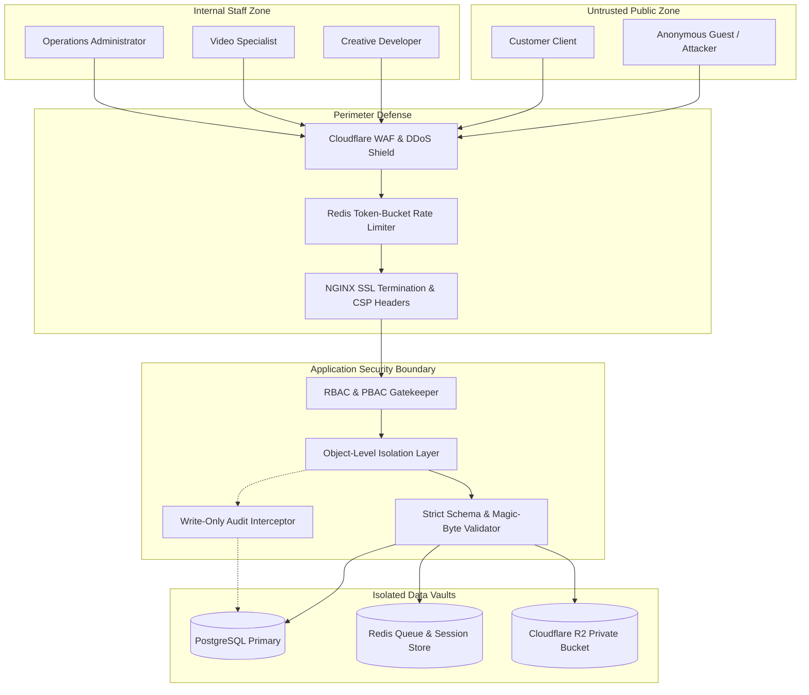

# TechMasters Digital Celebrations
## Security Architecture & Threat Mitigation Document — Version 1.0

---

### Document Control
- **Product Name:** TechMasters Digital Celebrations
- **Document Version:** 1.0
- **Author:** Principal Security Engineer & Lead Architect
- **Baseline Reference:** BRD v1.1, SAD v1.0, FRS v1.0, ERD v1.0

---

## 1. Security Architecture & Threat Modeling

The platform operates across four primary security boundaries: Public Edge, Customer Client, Developer Workspace, and Admin Control Plane.



---

## 2. Authentication & Credential Management

### 2.1 Internal Staff Authentication (Admin & Developers)
- **Password Hashing:** Utilizes the memory-hard `Argon2id` algorithm with configurable iterations ($t=3$, $m=65536$, $p=4$) preventing GPU-accelerated rainbow table attacks.
- **Session Tokens:** Stateless RFC 7519 JSON Web Tokens (JWT) signed with `RS256` (asymmetric RSA 2048-bit key) or high-entropy `HS256` secret.
  - Access Token TTL: 15 minutes.
  - Refresh Token TTL: 7 days with automatic token rotation.
  - Immediate Invalidation: If an Admin suspends a developer account, all active refresh tokens for that developer UUID are blacklisted in Redis immediately.

### 2.2 Customer Verification (Passwordless Mobile OTP)
- Customers do not manage passwords. Verification is handled via 6-digit cryptographic OTPs.
- **OTP Generation:** Cryptographically secure pseudo-random number generator (`secrets.SystemRandom().randint(100000, 999999)`).
- **Storage:** Stored in database/Redis as an HMAC-SHA256 digest (`HMAC(server_secret, otp)`), never in plain text.
- **Rate Limiting:**
  - Maximum 3 OTP dispatch requests per mobile number per 10 minutes.
  - Maximum 3 failed verification attempts before the challenge is permanently invalidated.
  - Strict 5-minute Time-To-Live (TTL).

---

## 3. Object-Level Authorization & Anti-IDOR Protections

Insecure Direct Object Reference (IDOR) is a critical vulnerability in ticketing platforms. TechMasters prevents IDOR through layered database filters:

### 3.1 Developer Workspace Query Scoping
Developers cannot access arbitrary tickets simply by guessing or iterating UUIDs:
```python
# Django REST Framework Queryset Enforcement
def get_queryset(self):
    user = self.request.user
    if user.role in ['OPS_ADMIN', 'SUPER_ADMIN']:
        return Ticket.objects.all()
    # Developers can only view their own assigned tickets
    return Ticket.objects.filter(assigned_developer=user)
```

### 3.2 Customer Order Scoping
Customers querying order details, previews, or deliverables must present a valid `customer_session_token` whose decoded mobile number matches `order.customer_mobile`. Direct access via arbitrary `order_reference` without session ownership returns HTTP 403 Forbidden.

---

## 4. File Upload Validation & Storage Hardening

Uncontrolled file uploads pose severe remote code execution (RCE) and malware distribution risks.

### 4.1 Strict Upload Validation Pipeline
1. **Extension Whitelisting:** Strictly limited to `.jpg`, `.jpeg`, `.png`, `.mp3`, `.wav`. Executable files (`.exe`, `.sh`, `.php`, `.js`) and HTML/SVG uploads from customers are rejected.
2. **MIME-Type & Magic Byte Inspection:** The server inspects the raw file header using `python-magic` to verify true binary format rather than relying on client-supplied `Content-Type` headers.
3. **Storage Isolation:** Uploads are stored in private Cloudflare R2 buckets with randomized UUID file keys (`assets/raw/{uuid4}.bin`). Files are never served with execution permissions.
4. **Time-Bounded Pre-Signed URLs:** Deliverables and raw assets are accessed strictly via pre-signed S3 URLs with an expiry TTL of 15 minutes.

### 4.2 Protected Design Previews
- Previews are protected via one-time tokens and watermarked programmatically (diagonal high-contrast dynamic text: `"TECHMASTERS PREVIEW - NOT FINAL"`).
- Direct high-resolution source code or card graphic masters are NEVER accessible in preview mode.

---

## 5. Publishing Air-Gap Enforcement

A core business and security rule of the platform:
$$\text{Live Publication} \iff (\text{Payment Status} = \text{'VERIFIED\_SUCCESS'}) \land (\text{Admin Authorized} = \text{TRUE})$$

- An automated script or rogue customer cannot activate public URLs or high-resolution downloads simply by reaching a success screen.
- Server validation checks:
  1. Has the payment gateway signature been validated using server-side webhook secrets?
  2. Does the settled amount equal or exceed the total order invoice?
  3. Has an Admin user with role `OPS_ADMIN` or `SUPER_ADMIN` executed the `/api/v1/admin/publishing/authorize/` endpoint?
- If any check fails, public URL generation and deliverable unlocking are completely aborted.

---

## 6. Payment Webhook Security & Idempotency

- **Cryptographic Signature Verification:** Every incoming payment gateway webhook is validated by computing HMAC-SHA256 over the raw request body with the gateway secret and comparing it using constant-time comparison (`hmac.compare_digest`).
- **Webhook Idempotency:** Payment providers frequently retry webhooks. TechMasters maintains an idempotency table recording processed `gateway_payment_id` values. Duplicate webhooks are acknowledged with HTTP 200 OK without re-triggering business logic or state changes.

---

## 7. Immutable Central Audit Trail Protections

- The `central_activity_logs` table has zero `UPDATE` or `DELETE` grants in PostgreSQL for the application user.
- Any attempt to truncate, modify, or delete audit records raises a database-level trigger exception.
- Audit logs capture actor IP, user agent, actor role, action enum, affected record, and before/after JSON diffs.

