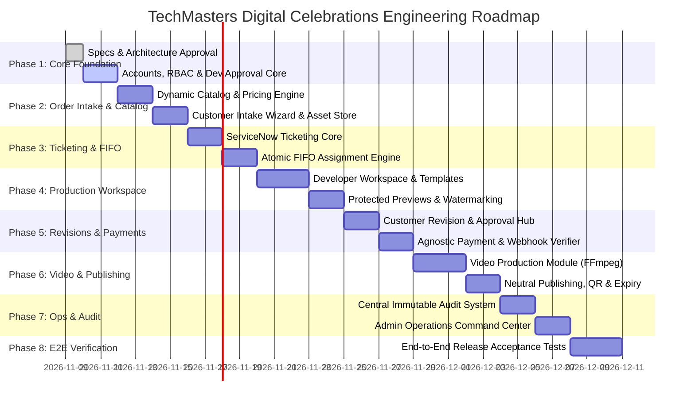

# TechMasters Digital Celebrations
## Development Roadmap & Modular Implementation Plan — Version 1.0

---

### Document Control
- **Product Name:** TechMasters Digital Celebrations
- **Document Version:** 1.0
- **Author:** Principal Software Architect & Technical Program Manager
- **Baseline Reference:** BRD v1.1, SAD v1.0

---

## 1. Modular Execution Strategy

Development is executed in eight strictly ordered, testable modules. Each module produces runnable, verified code before downstream dependencies are integrated.

---

## 2. Phase-by-Phase Deliverables

### Module 1: Accounts, RBAC & Developer Approval Engine
- Custom User model supporting Staff (Admin/Dev) and OTP Customer sessions.
- Argon2 password hashing and JWT authentication.
- Developer registration with `PENDING_APPROVAL` status.
- Admin developer review and approval API (`APPROVE`, `SUSPEND`, `REACTIVATE`).
- Role & capability permission enforcement classes in DRF.

### Module 2: Catalog, Dynamic Pricing & Customer Order Intake
- Occasion categories (Birthday, Naming Ceremony, Anniversary, Engagement, Marriage).
- Packages and Add-ons data models (no hard-coded prices).
- Customer order intake wizard with multi-event scheduling and multilingual selection.
- Unique ticket reference generation (`TC-YYYY-XXXXX`).
- Secure customer asset upload handler for photos and audio.

### Module 3: ServiceNow-Style Ticketing & Concurrency-Safe FIFO Engine
- Full ticket model with lifecycle status machine and state transition hooks.
- Internal notes and customer communications models.
- Concurrency-safe FIFO self-assignment queue using `SELECT ... FOR UPDATE SKIP LOCKED`.
- Developer active ticket workload throttling and assignment history tracking.
- Admin manual assignment and reassignment overrides.

### Module 4: Developer Workspace & Design Studio
- Authenticated developer workspace displaying active workload and available queue.
- Reusable invitation template architecture.
- Design versioning and protected preview generator with dynamic watermarking.
- Customer feedback and revision changelog viewer.

### Module 5: Customer Revisions, Approval & Payment Verification
- Tokenized preview viewer for customer.
- Customer revision request workflow (first 2 free, billable tracking thereafter).
- Design approval lock.
- Payment gateway integration with server-side signature verification and webhook idempotency.

### Module 6: Video Production & Neutral Publishing Subsystem
- Role-gated video task management (`can_produce_video` permission).
- FFmpeg media processing pipeline for animated MP4 invitations.
- Neutral domain path publishing (`neutral-domain.vercel.app/:slug`).
- Dynamic QR code generation (SVG & PNG).
- Automated post-event expiration monitor with configurable grace periods.

### Module 7: Central Audit Telemetry & Admin Operations Center
- Append-only immutable activity log table with database-level update/delete block.
- Structured event logging across all lifecycle actions with before/after state diffs.
- Admin dashboard metrics (Queue health, Developer workloads, Revenue audit, SLA alerts).
- Multi-parameter audit log search and inspection interface.

### Module 8: Full-Stack Integration & Acceptance Testing
- Automated unit and integration test suites.
- End-to-end user journey validation across Customer, Developer, and Admin portals.
- Load and concurrency stress testing on the FIFO assignment queue.

